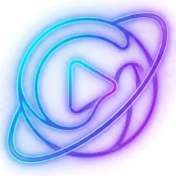

<div align="center">
  
  <h1>SpaceMusic</h1>
  <p>Player Android de música do YouTube Music, sem anúncios, com download para ouvir offline.</p>
  <p>Baseado no <a href="https://github.com/fast4x/RiMusic">RiMusic</a> 0.6.76 de fast4x.</p>
</div>

## O que muda em relação ao RiMusic 0.6.76

- **Reprodução completa**: usa o cliente `VISIONOS` como primeira alternativa de stream. O cliente `IOS` sem PoToken é cortado pelo YouTube depois de ~1 MB (~30 s) e o `TVHTML5_SIMPLY_EMBEDDED_PLAYER` foi desativado.
- **Validação de stream**: o link é testado com um pedaço do meio do arquivo (não só `HEAD`), então links cortados (ex.: `WEB_REMIX` logado sem PoToken) são descartados e o próximo cliente é usado.
- **visitorData**: renovado automaticamente quando está vazio, vencido ou o YouTube pede login.
- **Inicialização**: a configuração do Environment é carregada em `MainApplication.onCreate`, antes do serviço do player (antes, às vezes todas as requisições iam para `localhost`).
- **Capas nítidas**: suporte ao host `yt3.googleusercontent.com` no redimensionamento das capas (antes ficavam em 60x60).
- **Nova identidade**: nome SpaceMusic, ícone e logo novos.

## Compilar

Requisitos: JDK 21 e Android SDK 35.

O build lê ~39 propriedades de configuração do cliente do YouTube (`propertyOrEmpty(...)` em `composeApp/build.gradle.kts`). Elas **não** ficam no repositório; coloque-as em `~/.gradle/gradle.properties`. Sem elas o app compila, mas não carrega conteúdo.

```bash
./gradlew :composeApp:assembleFullRelease
```

O APK sai em `composeApp/build/outputs/apk/full/release/`.

## Créditos e licença

- [RiMusic](https://github.com/fast4x/RiMusic) por fast4x e colaboradores. O README original está em [README.rimusic.md](README.rimusic.md).
- Distribuído sob a [GNU GPL v3.0](LICENSE), a mesma licença do projeto original.

SpaceMusic não é afiliado ao YouTube nem ao Google.
